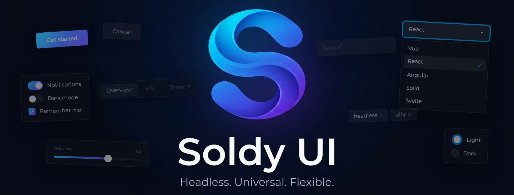

<p align="center">
  
</p>

# Soldy UI

**UI components with the logic written once: a framework-agnostic core and thin adapters that
render it in Vue, React, Angular, Svelte, Solid and Web Components.**

[](https://github.com/youra-h/soldy/actions/workflows/ci.yml)
[](https://www.npmjs.com/org/soldy-ui)
[](LICENSE)

> **Status:** version `0.3.0-alpha.3`, a pre-release on npm. From this version on, every released
> component in [the component table](#components) is available in all six adapters: Vue, React,
> Angular, Svelte, Solid and Web Components. Early development: until `1.0`, any release may change
> the API.

## What it is

The behavior of a Soldy UI component lives in a headless core with no framework in it: component
models in plain TypeScript that own their state, events, collections and ARIA. Behavior that needs
the DOM — focus, keyboard, overlay — comes as plugins, and the component contract (props, events,
slots) is declared once, in a descriptor. Thin adapters for Vue, React, Angular, Svelte, Solid and
Web Components connect that model to a framework and render the markup: BEM classes `so-*` and
`data-*` state attributes. The look comes from a theme, shipped as a separate package.

## Why Soldy UI

- **Logic is written once.** Behavior lives in the core, plugins and collection extensions, and an
  adapter only wires it up. Reactivity and lifecycle hooks stay in the adapter layer of each
  package; ESLint rules and tests keep them out of components.
- **One contract for every framework.** Props, events and slots are declared in the descriptor, and
  every adapter derives its API from it. Names match across frameworks; only the spelling follows
  each one's conventions: `@change:text` in Vue, `onChangeText` in React.
- **Two equal ways to drive a component.** Configure it in the template, or create a core instance,
  pass it as `ctrl` and work with it from code: both sides see the same state and events. Plugins
  are reachable from the instance too, through the `bundle:create` event.
- **Collections are an engine, not an array.** Tabs, Accordion, ListBox, Select, Tags and
  RadioGroup run on the same engine with pluggable extensions: selection, activation, order,
  filtering. Every insert, update, remove, move and clear first emits a cancellable `*:before`
  event, and items come from the `items` prop or from markup. Calendar is a collection too: its
  days are items, built from the months on screen. A Table is two: rows and columns.
- **Accessibility from the WAI-ARIA Authoring Practices.** Tabs, Tags, Accordion, Select, Switch,
  RadioGroup, Slider, Rating, NumberInput, Popover, Tooltip, Dialog, Drawer, Calendar, DatePicker
  and Table take roles and relations from their APG patterns, and ProgressLinear and
  ProgressSpinner use the `progressbar` role. Select implements the Combobox keyboard model, and
  Tabs the Tabs one: arrow keys and Home/End with automatic activation, and a single Tab stop. ARIA
  is computed outside the framework and rendered with the markup, so it is in place from the first
  render.
- **Themes and icon packs are pluggable contracts.** A theme styles `so-*` classes and `data-*`
  attributes, never `aria-*`, so an accessibility fix does not break the look. An icon pack is
  plain data for a fixed set of roles, with no bundler-specific imports.
- **Rules are enforced, not just written down.** TypeScript runs in `strict` mode with no escape
  hatches: `as any`, `as unknown as X`, non-null `!` and `@ts-ignore` fail CI. Key architectural
  rules have guard tests, and the playground layout is checked in real Chromium, not in jsdom.

## Installation

Install the adapter for your framework, a theme and an icon pack. The adapter brings the core
(`@soldy-ui/core`, `@soldy-ui/plugins`, `@soldy-ui/setup`) with it.

| Framework      | Install                         | Requires        |
| -------------- | ------------------------------- | --------------- |
| Vue            | `npm install @soldy-ui/vue`     | Vue 3.5.21+     |
| React          | `npm install @soldy-ui/react`   | React 19.2+     |
| Angular        | `npm install @soldy-ui/angular` | Angular 22.2+   |
| Svelte         | `npm install @soldy-ui/svelte`  | Svelte 5.55.10+ |
| Solid          | `npm install @soldy-ui/solid`   | Solid 1.9.10+   |
| Web Components | `npm install @soldy-ui/webc`    | —               |

The theme and the icon pack are the same for every adapter:

| Package | Install                                                                        |
| ------- | ------------------------------------------------------------------------------ |
| Theme   | `npm install @soldy-ui/theme-oren`                                             |
| Icons   | `npm install @soldy-ui/icons-material` or `npm install @soldy-ui/icons-lucide` |

All `@soldy-ui/*` packages share one version; keep them on the same one. Then plug in the theme and
the icons at the application entry point, as shown below.

## What it looks like

The examples use Vue and are based on the adapter tests and the playground.

Compound components name their parts with a dot:

```vue
<script setup lang="ts">
import { Accordion } from '@soldy-ui/vue'
</script>

<template>
  <Accordion mode="multiple">
    <Accordion.Item text="First" value="a" :selected="true">
      <p>Content A</p>
    </Accordion.Item>
    <Accordion.Item text="Second" value="b">
      <p>Content B</p>
    </Accordion.Item>
  </Accordion>
</template>
```

The same component can be driven from code — pass a core instance as `ctrl`:

```vue
<script setup lang="ts">
import { TButton } from '@soldy-ui/core'
import { TActionPlugin, TPluginBundle } from '@soldy-ui/plugins'
import { Button } from '@soldy-ui/vue'

const btn = new TButton({ text: 'Save', variant: 'accent' })

// Plugins are reachable from the instance, without the template
btn.events.on('bundle:create', (bundle: unknown) => {
  if (bundle instanceof TPluginBundle) {
    bundle.get(TActionPlugin)?.events.on('press', () => {
      btn.disabled = true // the rendered button updates
    })
  }
})
</script>

<template>
  <Button :ctrl="btn" />
</template>
```

The application plugs in a theme and an icon pack. The theme comes in two parts: the stylesheet and
its behavior (`./setup`) — the plugins whose values its CSS reads, such as the bar under the active
tab:

```ts
import { createApp } from 'vue'
import { useIcons, useTheme } from '@soldy-ui/setup'
import * as material from '@soldy-ui/icons-material'
import App from './App.vue'

import '@soldy-ui/theme-oren'
import oren from '@soldy-ui/theme-oren/setup'

useIcons(material)
useTheme(oren)

createApp(App).mount('#app')
```

The dark scheme is switched on with `<html data-so-theme="oren-dark">`.

Motion — panels sliding in, thumbs travelling, indicators running — follows the system's
reduced-motion setting by default. An application that wants motion regardless, or never, sets one
mode for the whole library at its entry point: `useMotion('full')` or `useMotion('reduce')` from
`@soldy-ui/plugins`.

Language and the strings the library draws itself — names of buttons without text (close, scroll,
clear) and of fields nothing else names — come as one value, a locale, from the nearest
`LocaleProvider` up the tree. The tag goes to Intl (date labels, first day of the week, the date
field format, table sorting), the strings are plain data with a `{name}` slot where a part's name
goes. Change the provider's locale and components pick it up without remounting; a nested provider
gives its subtree another language, and the server renders parallel requests each in its own:

```vue
<script setup lang="ts">
import { ref } from 'vue'
import { LocaleProvider } from '@soldy-ui/vue'
import { ruRU, zhCN } from '@soldy-ui/plugins'

const current = ref(ruRU) // current.value = zhCN switches on the fly
</script>

<template>
  <LocaleProvider :locale="current">
    <RouterView />
  </LocaleProvider>
</template>
```

Ready locales cover the six official UN languages (`enUS`, `ruRU`, `zhCN`, `frFR`, `esES`,
`arEG`). Any other is an object of type `TLocale` the application writes itself, or one built over
a ready locale: `extendLocale(enUS, { tag: 'mn-MN', translations: { modal: { close: 'Хаах' } } })`.

## Components

The component set, as the playground shows it. **Frameworks** says which adapters already have the
component: `*` — all six, a list — only those, `-` — none yet. **Release** is the first release
on npm with the component in at least one adapter: a version number; `alpha` — already in `main`,
ships with the next alpha release; `future` — queued for development.

| Component       | What it is                                                                                     | Frameworks | Release       |
| --------------- | ---------------------------------------------------------------------------------------------- | ---------- | ------------- |
| Button          | Button: text, icons in slots, four views                                                       | *          | 0.3.0-alpha.1 |
| Input           | Text field with slots for icons and buttons                                                    | *          | 0.3.0-alpha.1 |
| NumberInput     | Number field in the locale's format: step and bounds, arrow keys, − and + buttons with hold    | *          | 0.3.0-alpha.1 |
| CheckBox        | Checkbox with a third, indeterminate state                                                     | *          | 0.3.0-alpha.1 |
| Switch          | Switch: the same value as a checkbox, a different metaphor                                     | *          | 0.3.0-alpha.1 |
| Label           | Control label: clicking the text toggles the control, and the text is its accessible name      | *          | 0.3.0-alpha.1 |
| Slider          | Slider: a number or a range, set by dragging, with keys or with a screen reader gesture        | *          | 0.3.0-alpha.1 |
| Rating          | Rating with stars: set by click, drag or arrow keys, halves, hover preview, read-only display  | *          | 0.3.0-alpha.1 |
| RadioGroup      | One option out of several: native radio buttons sharing a `name`                               | *          | 0.3.0-alpha.1 |
| Select          | Select field: an input plus a list in an overlay, the Combobox pattern                         | *          | 0.3.0-alpha.1 |
| Calendar        | Month grids: pick a single date, several dates or a range                                      | *          | 0.3.0-alpha.1 |
| DateInput       | Date and time field typed in parts in the locale's format, selected and copied as a whole      | *          | 0.3.0-alpha.1 |
| DatePicker      | Date field and a calendar in a panel: a single date or a range                                 | *          | 0.3.0-alpha.1 |
| Popover         | Panel at a trigger with any content: a non-modal dialog                                        | *          | 0.3.0-alpha.1 |
| Tooltip         | Hint for an element, shown on hover and on keyboard focus                                      | *          | 0.3.0-alpha.1 |
| Dialog          | Modal window: centered or at an edge of the screen, can be maximized to full screen            | *          | 0.3.0-alpha.1 |
| Drawer          | Panel that slides in at an edge of the screen or a container, can be swiped away               | *          | 0.3.0-alpha.1 |
| Toasts          | Pop-up notifications shown from code: a queue, auto-dismiss with a pause, swipe to close       | *          | 0.3.0-alpha.1 |
| Scroller        | Single-row strip of any content, paged with two buttons                                        | *          | 0.3.0-alpha.1 |
| ListBox         | List with single or multiple selection                                                         | *          | 0.3.0-alpha.1 |
| Table           | Table: columns as data, sorting by column headers, row selection with checkboxes               | *          | 0.3.0-alpha.1 |
| Tabs            | Tabs: a tab list and panels linked by value                                                    | *          | 0.3.0-alpha.1 |
| Tags            | Tag set: close buttons, optional selection                                                     | *          | 0.3.0-alpha.1 |
| Accordion       | Sections that expand one at a time or several at once                                          | *          | 0.3.0-alpha.1 |
| Icon            | Icon from the registered pack, by role                                                         | *          | 0.3.0-alpha.1 |
| ProgressLinear  | Linear progress indicator: the share done, or an indeterminate animation while it is unknown   | *          | 0.3.0-alpha.1 |
| ProgressSpinner | Circular progress indicator: the share done, or an indeterminate animation while it is unknown | *          | 0.3.0-alpha.1 |
| Skeleton        | Placeholder while content loads                                                                | *          | 0.3.0-alpha.1 |
| DragAndDrop     | Drag and drop of collection items                                                              | *          | 0.3.0-alpha.1 |
| Virtual         | Window for long lists: ListBox and Table inside render only the visible items                  | *          | 0.3.0-alpha.1 |
| Pagination      | Page navigation: page numbers with gaps, previous and next, first and last                     | *          | 0.3.0-alpha.1 |
| Menu            | Action menu at a button or on right click: submenus, checkbox and radio items                  | *          | 0.3.0-alpha.1 |
| Textarea        | Multi-line text field that grows with its content                                              | *          | 0.3.0-alpha.1 |
| Field           | Field wrapper: description, error message and invalid state linked to the control              | *          | 0.3.0-alpha.1 |
| Alert           | Inline message by severity: info, success, warning, error                                      | -          | future        |
| Badge           | Counter or status mark, on its own or over another element                                     | -          | future        |
| Avatar          | User picture with a fallback to initials or an icon                                            | -          | future        |
| Breadcrumbs     | Path to the current page, collapsing a long trail                                              | -          | future        |
| Separator       | Horizontal or vertical divider, semantic or decorative                                         | -          | future        |
| ToggleGroup     | Toggle button and a group of them with single or multiple selection                            | -          | future        |
| Tree            | Hierarchy with expandable branches, selection and keyboard navigation by level                 | -          | future        |
| Stepper         | Steps of a multi-step form: done, current, with an error; linear or free order                 | -          | future        |
| FileUpload      | File picker and drop zone with type, size and count limits                                     | -          | future        |
| Splitter        | Panels with a draggable border: size limits, keyboard, collapsing                              | -          | future        |

A new component comes to Vue first and moves to the other adapters after that.

## Repository structure

```
packages/
  core/             headless component models: components, collection engine, facades, extensions
  setup/            code shared by adapters, in two layers:
    protected/      mechanics: define, naming, registry, adapter context and exchange
    content/        what fills the library up: descriptors, adapter extensions, icon roles
  plugins/          runtime behavior installed into TPluginBundle: DOM, focus, keyboard, overlay
  ui/
    vue/            Vue adapter
    react/          React adapter
    angular/        Angular adapter
    svelte/         Svelte adapter
    solid/          Solid adapter
    webc/           Web Components adapter: Custom Elements
  themes/base/      shared layer of themes: reset, structure of the parts, layout plugins, checks
  themes/oren/      oren theme: CSS for the BEM classes and data-*, light and dark schemes
  icons/material/   Material icons implementing the ICON_ROLES contract
  icons/lucide/     Lucide icons implementing the ICON_ROLES contract
  playground/
    shared/         framework-free playground data: component registry, prop descriptions, enums
    vue/            Vue playground app
tools/
  eslint/           local ESLint rule (soldy/no-explicit-any) and tests for the lint blocks
  vite/             shared Vite library build config for the packages
  published-imports/  check that built packages declare every package they import
  agent-flow/       ClickUp ↔ Claude Code task pipeline
docs/               architecture overview
```

## Development

Node `^22.12.0 || ^24 || >=26`, npm workspaces.

```bash
npm install
npm run dev         # playground, with the theme rebuilt on change
npm run test:core   # core tests (Vitest)
npm run test:vue    # Vue adapter tests
npm run lint        # ESLint
```

The playground's overview page shows every component. A component page renders each prop twice —
from props and from a core instance passed as `ctrl` — with the code for both. Components are drawn
by the framework picked in the header (Vue, React, Angular, Svelte, Solid, Web Components); the
framework is the first segment of the address, `#/react/button`. The playground's pages, layout and
tests are described in [packages/playground/README.md](packages/playground/README.md). The rest of
the commands are listed in [AGENTS.md → Commands](AGENTS.md#commands).

## Roadmap

The goal is one component set with the same behavior, accessibility and look in all six targets.
On the way there:

- more themes and icon packs on the same contracts.

## Documentation

- [docs/architecture.md](docs/architecture.md) — architecture overview: layers, descriptors,
  plugins, collections, adapters (English and Russian).
- [AGENTS.md](AGENTS.md) — project rules and conventions, mostly in Russian.
- [packages/themes/base/README.md](packages/themes/base/README.md#make-your-own-theme) — how to
  make your own theme on the shared layer, step by step.
- [packages/themes/base/AGENTS.md](packages/themes/base/AGENTS.md) — the shared layer of themes:
  layers, the reset, the direction sign, the layout plugins, the checks every theme passes (in
  Russian).
- [packages/themes/oren/AGENTS.md](packages/themes/oren/AGENTS.md) — the oren theme: scales, color
  schemes, tokens (in Russian).
- [packages/playground/README.md](packages/playground/README.md) — the playground: hosts of the
  frameworks, pages, layout, tests.
- [ACCESSIBILITY.md](ACCESSIBILITY.md) — accessibility commitment, known limitations and how to
  report a barrier.
- [CONTRIBUTING.md](CONTRIBUTING.md) — how to report issues and propose changes.

## License

[MIT](LICENSE)
